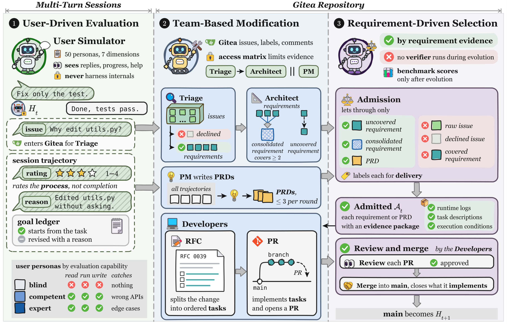
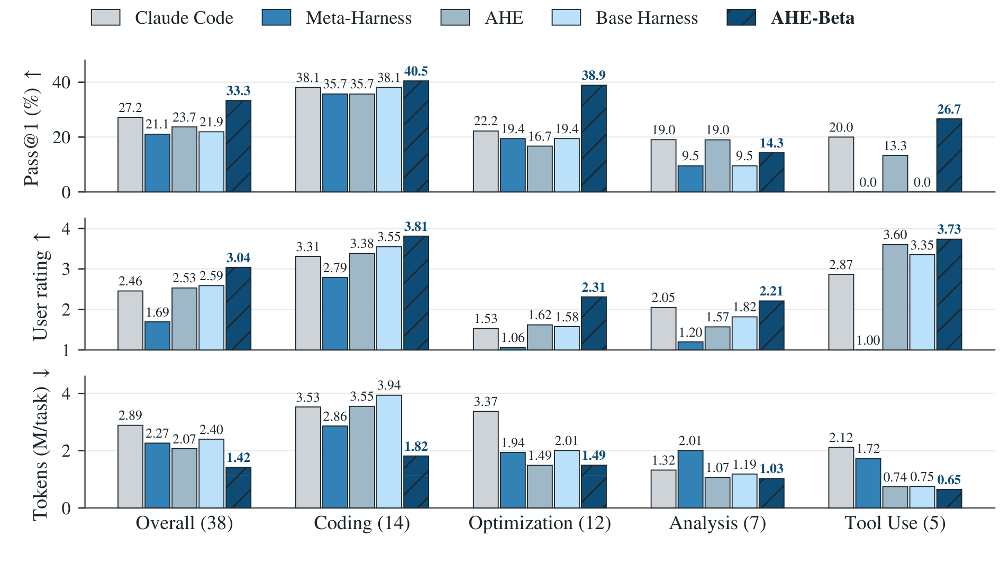
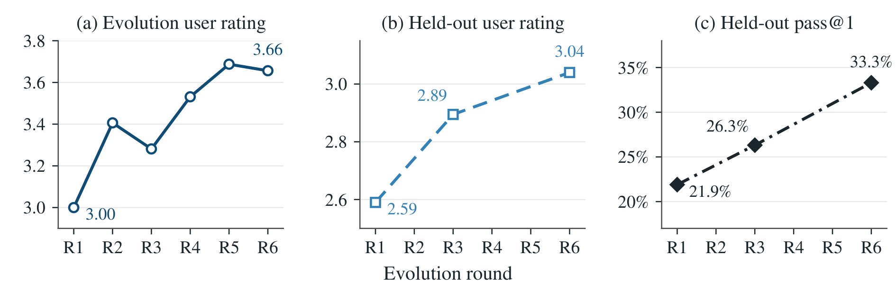

<!--
  Bilingual post. The English and Chinese bodies are two sibling divs and the
  中/EN switch hides one of them. Edit BOTH when changing any wording.
-->

> **TL;DR** AHE-Beta evolves an agent harness from what users need rather than from benchmark scores. A user simulator raises requirements, and a Triage, Architect, PM and Developers team turns them into general fixes. On 38 held-out tasks, pass@1 rises from 21.9% to 33.3% with 40.8% fewer tokens, and real users preferred AHE-Beta in 31 of 48 blind pairs.

[Paper](https://arxiv.org/abs/2611.24924) ｜ [Code](https://github.com/Curry09/AHE-Beta)

Self-evolving harness algorithms are still at a rough, early stage, and they face two problems. The first is benchmark overfitting. Early methods sample from a subset of some benchmark and optimize the harness from the sampled trajectories and verifier outcomes, yet they have no effective way to check whether the harness is any better in real use. The second is an indirect effect of the first. Benchmarks contain a limited number of tasks, and the training set used for evolution usually holds only a few dozen. It is easy to see that writing a rule for each kind of prompt, prescribing the matching behavior, is enough to score well on these tasks, and this is essentially a skill. Faced with a biology question, for example, feed the model the relevant biology and a standard solution procedure and it will naturally do well. A harness modified this way is tailored to a handful of training tasks, which is in some sense a form of reward hacking.

Real-world harness engineering never works like this. When an engineer sees a task go badly, they do not patch that task. They ask what lies behind it, whether some harness mechanism is broken or the model simply lacks the capability. Existing self-evolving harness algorithms, by contrast, tend to overfit the training set and rarely produce a truly general harness.

We therefore propose Agentic Harness Engineering Beta (AHE-Beta), an algorithm that aligns harness self-evolution with real-world engineering practice. It has two parts. The first steps outside the benchmark and uses feedback from a user simulator as the evolution signal. The user simulator receives only the task description, works with the harness in the workspace to complete the task, and gives an evaluation at the end. The evaluation has two components. One is the issues filed during the session, for example the harness modified files it was not allowed to touch, or ran for a long time without reporting progress. The other is a user rating from 1 to 4 with a short reason at the end of the session. The user simulator is driven by user personas. We distilled 50 personas from real developers' public writing and GitHub activity, each recording that user's acceptance criteria, how much autonomy they expect from the harness, and how well they can check code themselves. Some users only care whether the final result runs, some want evidence for every step, and some hate it most when the harness deletes files without asking. These preferences never appear in the task description and verifiers never check them, yet they are exactly what separates a good harness from a bad one in the real world. The user simulator also sees only the harness's replies and none of its internals, matching how we use coding agents every day, judging their reliability from what they say and do.

The second part hands harness modification to a team. Existing methods usually let a single agent analyze failed trajectories and then patch the code. The problem is that one root cause shows up as different symptoms on different tasks. A single evolver sees one symptom at a time and gradually accumulates many conflicting special cases. Real software teams do not work this way. So we set up a small team in a Gitea repository. Triage screens issues, rejects those that belong to the user's task itself, are invalid, or only help individual tasks, and rewrites the kept issues as requirements free of project names and answers. Architect merges requirements that share a root cause into one structural requirement. PM looks past individual issues and mines, across all sessions and users, requirements that keep recurring yet nobody states. Developers write an RFC first, then implement the code and open a pull request. A pull request reaches the main branch only if it maps to a requirement backed by session evidence and passes design review and code review. The whole evolution never consults benchmark scores, and benchmarks are used only for evaluation after evolution ends. This is what alignment with the real world means. Engineers change code because users raise reasonable requirements, not because a number on a leaderboard goes up.

<figure><figcaption>Overview of AHE-Beta in one round. The user simulator files issues and ratings, and Triage, Architect, PM and Developers turn them into merged harness changes.</figcaption></figure>

We evaluate on 38 held-out tasks from Harbor-index that share nothing with the evolution tasks and span four domains, Coding, Optimization, Analysis and Tool Use. The execution model is the low-cost GLM-5.3-Flash. Compared with the starting Base Harness, AHE-Beta raises pass@1 from 21.9% to 33.3% and user rating from 2.59 to 3.04 while cutting tokens by 40.8%, and its pass@1 also exceeds Claude Code, Meta-Harness and AHE. More importantly, in all four domains without exception, pass@1 and user rating both rise and tokens fall. Tool Use goes from 0.0% to 26.7% and Optimization from 19.4% to 38.9%. Meta-Harness, which selects changes by score, gains in none of the four domains and loses user rating in all of them. This confirms the benchmark overfitting problem above, since changes selected by score stop working once the tasks change.

<figure><figcaption>Main results on 38 held-out tasks with GLM-5.3-Flash, by domain. Bars show the mean over three runs, and hatched bars mark AHE-Beta.</figcaption></figure>

<figure><figcaption>AHE-Beta across evolution rounds, with R1 denoting Base Harness. Panels show evolution user rating, held-out user rating and held-out pass@1.</figcaption></figure>

Approval from the user simulator is not enough on its own, since it is itself a model. So we ran a blind A/B study with real users. Across 48 valid pairs, real users preferred AHE-Beta 31 times and rated it higher on all five dimensions, process understandability, usefulness, controllability, user burden and ease of use. The largest gain is in process understandability, from 4.13 to 5.33. The evolved harness is not only better at finishing tasks but also better at communicating, explaining how far it has progressed and on what basis it judges a step complete. This result agrees in direction with the user simulator and further supports driving evolution with simulated users.

<figure><table><thead><tr><th>Measure</th><th>Base Harness</th><th>AHE-Beta</th><th>Higher</th><th>Equal</th><th>Lower</th></tr></thead><tbody><tr><td>Overall</td><td>5.39</td><td><strong>6.01</strong></td><td>31</td><td>10</td><td>7</td></tr><tr><td>Process understandability</td><td>4.13</td><td><strong>5.33</strong></td><td>29</td><td>15</td><td>4</td></tr><tr><td>Usefulness</td><td>5.40</td><td><strong>6.15</strong></td><td>16</td><td>26</td><td>5</td></tr><tr><td>Controllability</td><td>5.23</td><td><strong>5.77</strong></td><td>18</td><td>25</td><td>4</td></tr><tr><td>User burden</td><td>5.98</td><td><strong>6.27</strong></td><td>17</td><td>25</td><td>6</td></tr><tr><td>Ease of use</td><td>6.21</td><td><strong>6.54</strong></td><td>14</td><td>29</td><td>5</td></tr></tbody></table><figcaption>Blind A/B study with real users on 48 valid pairs. Mean scores use a 1 to 7 scale, higher is better. Higher, Equal and Lower count the pairs where AHE-Beta scores above, equal to or below Base Harness, and the Overall row counts overall preference.</figcaption></figure>

Another finding deserves attention. Among all sessions that passed the verifier, 34 never delivered a complete reply to the user, and the user simulator gave every one of them the lowest rating of 1. The verifier checks only the final workspace state, so correct code counts as a pass. From the user's side, however, a harness that finishes the work without saying anything leaves the user unable to know the task is done and afraid to use the result. Verifiers can never discover this kind of requirement. It only becomes visible from the user's position. We also compared evolution with and without interaction. The version where the user only reviews the final result reaches 23.7% pass@1, the version with interaction reaches 28.9%, and uses only about half the tokens. Mid-run corrections from the user are themselves a highly valuable signal.

Finally, we transfer the harness evolved on GLM-5.3-Flash, without any re-evolution, to GLM-5.3 and DeepSeek-V4.1-Flash, where pass@1 exceeds Base Harness by 15.8 and 5.3 points respectively. What evolution produced is not a trick for one model but general improvements at the level of harness mechanisms, such as retaining user constraints, responding to mid-run corrections, and grounding progress and verification in workspace facts. These improvements apply to any model.

Two examples show why AHE-Beta builds harnesses that fit what real users need. The first is delivering corrections. In a pydicom evolution session, the user had already pointed to a two-line fix, yet the assistant kept investigating for 309 seconds without making any edit. The user told it to act now, but the message sat in a queue the model never read, and the user finally had to kill the run. After the first round, the harness began handing queued messages to the model before the next model call. In the second round, a correction landed during a 156-second model call and waited about 122 seconds before delivery, while the user saw only a queued notice. So after the second round, every message came with a receipt stating its wait time and delivery status. In the third round, the user still waited about 121 seconds and interrupted twice. After the third round, once a correction has waited more than 90 seconds, the harness cuts the current model call and reissues it with the correction attached. From then on every correction reached the model about 1.5 seconds after the cut, and the session's user rating rose from 1 to 3. This change was not conceived in one go. It was pushed forward step by step by the same user's dissatisfaction across three rounds, exactly the signal single-shot verifier feedback cannot give.

The second example is the stall nudge. In several evolution sessions, the user had already said where to change the code, yet the assistant kept reading. The harness now classifies every command as an edit or a read, and once read-only steps exceed a step or time limit, it inserts a nudge into the next model call asking the model either to start modifying or to explain where it is stuck, and the user sees the same counter. On the held-out task Pillow filter, Base Harness first modified the library source at second 1452 and still had not replied when time ran out. AHE-Beta received the nudge at second 151, wrote a benchmark script 22 seconds later, rewrote the core loop after the second nudge, and at second 926 delivered a 2.0x speedup with a passing equivalence check. Base Harness failed this task in all three runs.

The two examples have one thing in common. Neither is a patch for a particular task. Both are problems users kept running into, which the team generalized into harness mechanisms, one making user corrections arrive in time, the other making an idling assistant act in time.

This work still has many limitations. Limited by time and compute, we used at most 32 scenarios and six rounds of evolution, the user simulator relies on a single model, and the personas were curated. More scenarios and more diverse simulators may surface more requirements. Biased personas may also tilt the harness toward particular groups, and an overly proactive harness may overstep when requirements are unclear. These questions are left for future work. What I look forward to most is feedback that no longer comes from simulated users but from large numbers of users in real deployments, where everyone owns a harness branch that evolves for them.

<strong>A note from the author.</strong> There is a deeper principle behind harness self-evolution. Large language models are built on the Transformer, which relates the current position to the input text through attention and then predicts the next token. In this process the input determines the output distribution. Feed in high-quality text and the model tends to produce high-quality text, feed in a mess and the output becomes a mess too. Context therefore matters as much as model parameters. One view holds that prompt tuning, appending distilled experience to the prompt, has an effect close to a round of LoRA fine-tuning. Intuitively, appended experience shifts the output distribution, and LoRA, by stacking low-rank adapters on the attention and feed-forward layers, likewise changes the output for the same input. From prompt tuning to skill optimization to today's harness self-evolution, these are in some sense all equivalent to model training, yet they achieve better results in specific domains with less compute and time. I call this family of methods in-context reinforcement learning, and it is why I firmly chose harness self-evolution.

> **TL;DR** AHE-Beta 依据用户需求而非基准分数来进化 harness。模拟用户提出需求，由 Triage、Architect、PM 和 Developers 组成的团队将其转化为通用修复。在 38 个留出任务上，pass@1 从 21.9% 提升至 33.3%，token 用量减少 40.8%，真人盲测 48 个配对中有 31 次更偏好 AHE-Beta。

[Paper](https://arxiv.org/abs/2611.24924) ｜ [Code](https://github.com/Curry09/AHE-Beta)

现有的 harness 自进化算法仍处于粗糙的早期阶段，主要面临两个问题。第一是刷榜。早期算法通常在某个基准测试的子集上采样，依据采样轨迹和验证器的结果优化 harness，却缺乏有效手段检验 harness 在真实使用时是否更好。第二是刷榜带来的间接影响。基准测试的题目数量有限，用于进化的训练集通常只有几十个样本。不难想到，只要为每类提示词写好规则，规定相应的行为，就能在这些题目上取得好成绩，这本质上就是skill。例如面对一道生物题，把相关的生物知识和标准解题流程直接塞给模型，它自然能做好这道题。这样改出的 harness 只是针对训练集中的几道题量身定制，某种程度上也是一种奖励欺骗。

真实世界的 harness 工程从不如此。工程师看到某道题做得不好，不会给这道题单独打补丁，而是追问背后的原因，是 harness 的某个机制出了问题，还是模型能力不足。现有的 harness 自进化算法却往往过拟合训练集，难以产出真正通用的 harness。

为此，我们提出 Agentic Harness Engineering Beta（AHE-Beta），一个使 harness 自进化与真实世界工程实践对齐的算法。它主要包含两部分。第一部分跳出基准测试的框架，以模拟用户的反馈作为进化信号。我们只向模拟用户提供题目描述，由其在工作区中与 harness 协作完成任务，并在结束后给出评价。评价由两部分组成。一是会话过程中提交的问题报告，例如 harness 修改了未经允许的文件，或长时间运行却不汇报进展。二是会话结束时给出的 1 到 4 分用户评分及简短理由。模拟用户的灵魂通过用户画像来驱动。我们从真实开发者的公开文章和 GitHub 活动中提炼出 50 个用户画像，每个画像记录了该用户的验收标准、对 harness 自主程度的期望以及自身检查代码的能力等特征。有的用户只关心最终结果能否运行，有的用户要求每一步都给出证据，有的用户最反感 harness 在删除文件前不加确认。这些偏好不会写进任务描述，验证器也从不检查，却正是真实世界中区分 harness 好坏的关键。此外，模拟用户只能看到 harness 的回复，无法看到其内部实现，这与我们日常使用编程智能体的体验一致，只能根据它的言行判断它是否可靠。

第二部分将 harness 的修改交给一个团队。现有方法通常由一个智能体分析失败轨迹，然后为代码打上补丁。问题在于，同一根因会在不同任务上表现为不同症状，单个进化智能体每次只看到一个症状，久而久之便积累出大量相互冲突的特例。真实的软件团队并非如此工作。因此，我们在一个 Gitea 仓库中组建了一个小型团队。Triage 负责筛选问题报告，拒绝那些属于用户任务本身、并不成立或仅对个别题目有效的报告，并将保留的报告改写为不含项目名称和答案的需求。Architect 将根因相同的需求合并为一条结构性需求。PM 不关注单条报告，而是跨越所有会话和用户，挖掘反复出现却无人明言的需求。Developers 先撰写 RFC，再实现代码并提交合并请求。一个合并请求要进入主分支，必须对应一条有会话证据支撑的需求，并通过设计评审和代码评审。整个进化过程从不参考基准分数，基准测试仅用于进化结束后的评测。这正是与真实世界对齐的含义，工程师修改代码，是因为用户提出了合理的需求，而不是因为榜单上的数字上涨。

<figure><figcaption>AHE-Beta 单轮流程。模拟用户提交问题报告和评分，Triage、Architect、PM 和 Developers 将其转化为合并进 harness 的改动。</figcaption></figure>

我们在 Harbor-index 的 38 个留出任务上进行评测，这些任务与进化任务没有任何重叠，覆盖编程、优化、分析和工具使用四个领域。执行模型为价格低廉的 GLM-5.3-Flash。与起点 Base Harness 相比，AHE-Beta 将 pass@1 从 21.9% 提升至 33.3%，用户评分从 2.59 提升至 3.04，同时 token 用量减少 40.8%，pass@1 也超过了 Claude Code、Meta-Harness 和 AHE。更重要的是，四个领域无一例外，pass@1 和用户评分全部上升，token 用量全部下降。其中工具使用从 0.0% 提升至 26.7%，优化从 19.4% 提升至 38.9%。反观依据分数选择改动的 Meta-Harness，在四个领域均未提分，用户评分全部下降。这恰好印证了前文所述的刷榜问题，依据分数选出的改动换一批题目便难以奏效。

<figure><figcaption>GLM-5.3-Flash 在 38 个留出任务上分领域的主结果。柱高为三次运行的均值，带斜线的柱为 AHE-Beta。</figcaption></figure>

<figure><figcaption>AHE-Beta 在各轮进化中的变化，R1 即 Base Harness。三个子图依次为进化时的用户评分、留出任务上的用户评分和留出任务上的 pass@1。</figcaption></figure>

模拟用户的认可还不足以说明问题，毕竟它本身也是一个模型。因此，我们邀请真实用户进行了盲测 A/B 实验。在 48 个有效配对中，真实用户有 31 次更偏好 AHE-Beta，并在过程可理解性、有用性、可控性、用户负担和易用性五个维度上都给出了更高的评分。提升最大的是过程可理解性，从 4.13 升至 5.33。这表明进化后的 harness 不仅更擅长完成任务，也更善于与人沟通，它会说明自己进展到哪一步，以及依据什么判断这一步已经完成。这一结果与模拟用户的判断方向一致，也进一步支持了以模拟用户驱动进化的做法。

<figure><table><thead><tr><th>维度</th><th>Base Harness</th><th>AHE-Beta</th><th>更高</th><th>持平</th><th>更低</th></tr></thead><tbody><tr><td>总体</td><td>5.39</td><td><strong>6.01</strong></td><td>31</td><td>10</td><td>7</td></tr><tr><td>过程可理解性</td><td>4.13</td><td><strong>5.33</strong></td><td>29</td><td>15</td><td>4</td></tr><tr><td>有用性</td><td>5.40</td><td><strong>6.15</strong></td><td>16</td><td>26</td><td>5</td></tr><tr><td>可控性</td><td>5.23</td><td><strong>5.77</strong></td><td>18</td><td>25</td><td>4</td></tr><tr><td>用户负担</td><td>5.98</td><td><strong>6.27</strong></td><td>17</td><td>25</td><td>6</td></tr><tr><td>易用性</td><td>6.21</td><td><strong>6.54</strong></td><td>14</td><td>29</td><td>5</td></tr></tbody></table><figcaption>真实用户盲测 A/B 实验，共 48 个有效配对。均分为 1 到 7 分，越高越好。更高、持平、更低为 AHE-Beta 得分高于、等于、低于 Base Harness 的配对数，总体一行统计的是整体偏好。</figcaption></figure>

另一个发现同样值得关注。在所有通过验证器的会话中，有 34 个从未向用户交付完整的回复，模拟用户均给出了最低的 1 分。验证器只检查最终工作区的状态，代码正确即算通过，但从用户的角度看，harness 完成工作却不作任何说明，用户既无从知道任务已经完成，也不敢使用其结果。这类需求验证器永远无法发现，唯有站在用户的立场才能看到。我们还比较了进化时有无交互的差异。仅让用户审阅最终结果的版本 pass@1 为 23.7%，有交互的版本为 28.9%，且 token 用量仅为前者的一半左右。可见用户在会话中途的纠正本身就是极有价值的信号。

最后，我们将在 GLM-5.3-Flash 上进化得到的 harness 不经任何重新进化，直接迁移到 GLM-5.3 和 DeepSeek-V4.1-Flash 上，pass@1 分别比 Base Harness 提高 15.8 和 5.3 个百分点。这说明进化得到的并非针对某个模型的技巧，而是 harness 机制层面的通用改进，例如牢记用户约束、响应中途纠正、依据工作区中的事实汇报进展和验证结果。这些改进对任何模型都同样适用。

我们将用两个例子来展示AHE-Beta为什么能打造出符合真实用户需求的Harness。第一个例子是纠正消息的送达。在 pydicom 的一个进化会话中，用户已经指明了一个两行的修复，助手却连续调查了 309 秒而不做任何编辑。用户要求它立即动手，这条消息却停在一个模型永远读不到的队列里，用户最终只能终止运行。第一轮之后，harness 改为在下一次模型调用前把排队的消息交给模型。第二轮中，一条纠正恰好赶上一次 156 秒的模型调用，等了约 122 秒才送达，用户只看到一条已排队的通知。于是第二轮之后，每条消息都会附带一张回执，写明等待时间和送达状态。第三轮中，用户仍然等了约 121 秒，并打断了两次。第三轮之后，纠正消息等待超过 90 秒，harness 就截断当前的模型调用，带上这条纠正重新发起。此后每条纠正在截断后约 1.5 秒便送达模型，该会话的用户评分从 1 分升到 3 分。这个改动不是一次想出来的，而是同一位用户连续三轮的不满逐步推出来的，这正是单次验证器反馈给不了的信号。

第二个例子是停滞提示。在多个进化会话中，用户已经指明要改哪里，助手却一直在读代码。harness 现在把每条命令区分为编辑和读取，一旦连续只读超过一定步数或时间，就在下一次模型调用中插入一条提示，要求模型要么开始修改，要么说明卡在哪里，用户也能看到同样的计数。在留出任务 Pillow filter 上，Base Harness 到第 1452 秒才第一次修改库源码，到时限仍未回复。AHE-Beta 在第 151 秒收到提示，22 秒后写出基准测试脚本，第二次提示后重写了核心循环，最终在第 926 秒交付了 2.0 倍的加速和通过的等价性检查。Base Harness 在三次运行中都没有通过这个任务。

这两个例子有一个共同点。它们都不是为某道题打的补丁，而是用户在使用中反复碰到的问题，被团队归纳成了 harness 的通用机制，一个让用户的纠正及时送达，一个让助手在空转时及时动手。

当然，这项工作仍有不少局限。受时间和算力所限，我们最多只使用了 32 个场景和六轮进化，模拟用户只采用了单一模型，用户画像也经过挑选。更多的场景和更多样的模拟器或许能挖掘出更多需求。此外，有偏的用户画像可能使 harness 偏向特定群体，过于主动的 harness 也可能在需求不明确时越界行事。这些问题有待后续研究。我更期待的是，未来的反馈不再来自模拟用户，而是来自真实部署中的大量用户，每个人都能拥有一个为自己进化的 harness 分支。

<strong>作者的话</strong>：Harness 自进化背后有一个更深层的原理。大语言模型以 Transformer 为基础，通过注意力机制将当前位置与输入文本相关联，进而预测下一个词元。在这一过程中，输入决定了输出的分布。输入高质量的文本，模型便倾向于输出相应的高质量文本，输入杂乱无章，输出也随之混乱。因此，上下文与模型参数同等重要。有一种观点认为，提示词调优，即在提示词后附加总结出的经验，其效果近似于一次 LoRA 微调。直观上，附加经验改变了输出分布，而 LoRA 通过在注意力层和前馈层上叠加低秩适配器，同样能在相同输入下改变输出。从提示词调优到技能优化，再到如今的 harness 自进化，在某种意义上都等价于模型训练，却能以更少的算力和时间在特定领域取得更好的效果。我将这一类方法统称为上下文强化学习，这也是我坚定选择 harness 自进化的原因。

